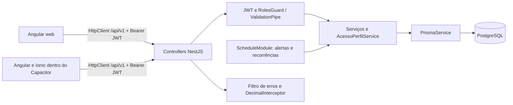

# Arquitetura implementada e banco de dados

As interfaces Angular web e Angular/Ionic compartilham o contrato HTTP, mas são aplicações separadas. O Capacitor empacota a interface mobile; não substitui a API NestJS. Os serviços das interfaces convertem modelos da API em modelos de apresentação, formatam valores e mantêm sessão. Guards da interface controlam navegação, enquanto a autorização efetiva é feita no backend.

O backend usa módulos NestJS, controllers para rotas, DTOs para validação e serviços para regras e transações. O acesso ao banco ocorre diretamente via PrismaService; não foi identificada uma camada independente de repositórios. O filtro de exceções padroniza respostas e oculta a mensagem interna de erros 500. DecimalInterceptor converte valores para o contrato JSON. Helmet e CORS são configurados no bootstrap HTTP.

No frontend web, a URL é local em desenvolvimento e da própria origem em hospedagem. No mobile, `src/environment.ts` contém uma URL local de desenvolvimento. Antes de distribuir o aplicativo, deve-se apontá-la para uma API HTTPS acessível ao dispositivo e configurar `CORS_ORIGINS` com as origens reais. Esta revisão não define um servidor de produção inexistente.

## Critérios financeiros observados

| Operação | Data de seleção | Estados incluídos | Interpretação |
|---|---|---|---|
| Receita/despesa normal no dashboard | `dataCompetencia` | PAGA | Lançamento pago atribuído à competência |
| Parcelas no total de despesas do dashboard | `dataVencimento` | PAGA, PENDENTE, VENCIDA | Compromissos do período, incluindo previsão |
| Saldo do dashboard | Mesmo período das linhas acima | Receita paga menos despesa paga e parcelas consideradas | Saldo com compromissos; não é extrato de caixa |
| Total parcelado em aberto | Sem filtro de período | PENDENTE, VENCIDA | Obrigação remanescente global do perfil |
| Relatório financeiro | Competência da transação / vencimento da parcela | Somente PAGA | Movimentações pagas atribuídas ao período de referência |
| Orçamentos | Competência / vencimento | Transações pagas e parcelas não canceladas | Comprometimento do mês |

`dataPagamento` registra o instante de quitação e não define o período dessas consultas. O teste antigo do dashboard e o cenário E2E chamavam esse comportamento de caixa e tinham expectativas incompatíveis com a implementação e com a regra explícita no serviço de relatórios. Corrigiram-se os testes e os subtítulos das duas interfaces; preservou-se a seleção financeira existente.

A divergência entre dashboard e relatório quando há parcelas pendentes é intencionalmente mantida e explicitada: um inclui compromissos e o outro exige pagamento. As regras originais RN05/RN08/RN09 não especificam um extrato por pagamento. Exemplo sintético: uma parcela paga hoje, com vencimento em três dias, entra no relatório do vencimento, não no relatório restrito ao dia de hoje. O E2E exercita ambos os intervalos. Não se deve comparar totais das duas telas como se representassem o mesmo conjunto quando há parcelas em aberto.

## Persistência real

O [diagrama-er.mmd](diagrama-er.mmd) é editável em Mermaid e contém os dez modelos, seus atributos escalares e as relações do schema. Os nomes exibidos são os nomes Prisma; `@@map` e `@map` definem nomes SQL. A representação usa a cardinalidade das relações reais, incluindo auto-relacionamento das recorrências. Campos opcionais e tipos SQL detalhados devem ser conferidos no schema; o diagrama é complementar ao dicionário abaixo.

| Modelo / tabela SQL | Chaves e atributos relevantes | Relações e integridade |
|---|---|---|
| Usuario / usuarios | UUID PK; email único; senhaHash; tipo; ativo; bloqueio e tentativas | 1:N perfis, refresh, redefinições e logs |
| RefreshToken / refresh_tokens | UUID PK; usuarioId FK; tokenHash único; expiração e revogação | Usuário com exclusão em cascata |
| TokenRedefinicaoSenha / tokens_redefinicao_senha | UUID PK; usuarioId FK; hash único; expiração e uso | Usuário com exclusão em cascata |
| PerfilFinanceiro / perfis_financeiros | UUID PK; usuarioId FK; documento; renda Decimal(14,2); seleção e ativo | Único usuário/documento; filhos financeiros em cascata |
| Categoria / categorias | UUID PK; perfilId FK; tipo; nome; orçamento Decimal(14,2) opcional | Único perfil/nome/tipo; referências de transações/contas não são exclusões em cascata |
| Transacao / transacoes | UUID PK; perfilId/categoriaId FKs; valor Decimal(14,2); competência e vencimento DATE; pagamento TIMESTAMPTZ; recorrência | Único origem/competência; FK de origem com SET NULL; índices de período, tipo/status e processamento |
| ContaParcelada / contas_parceladas | UUID PK; perfilId/categoriaId FKs; valorTotal Decimal(14,2); quantidade; dataCompra; status | 1:N parcelas; índice perfil/status |
| Parcela / parcelas | UUID PK; contaParceladaId FK; número; valor Decimal(14,2); vencimento DATE; pagamento TIMESTAMPTZ | Único conta/número; cascata com conta; índice status/vencimento |
| Alerta / alertas | UUID PK; perfilId FK; parcelaId FK único opcional; categoriaId FK opcional; chave única opcional | Perfil e parcela em cascata; categoria com SET NULL; leitura/descarte e prioridade |
| LogAuditoria / logs_auditoria | UUID PK; usuarioId FK obrigatório; perfilId FK opcional; ação, entidade e JSONs | Sem cascata de usuário/perfil; preservar histórico exige cuidado ao excluir dados |

As seis migrations foram aplicadas em banco vazio exclusivo. Elas criam o schema inicial, unicidade de alerta por parcela, campos visuais e de orçamento, descarte de alertas, recorrências e tipos/chaves de alertas de orçamento. Não foram executadas migrations sobre banco de desenvolvimento ou produção. O banco usa Decimal(14,2), mas os relatórios convertem valores para `number` durante as somas; ampliar cálculos exatos em todo o agregado é uma melhoria futura registrada, sem alegar precisão arbitrária.

A distribuição do parcelamento usa centavos inteiros, distribuindo o resto nas primeiras parcelas. As datas são calculadas a partir do vencimento original e limitadas ao último dia do mês de destino, evitando arrasto entre fevereiro e março. O cancelamento preserva parcelas já pagas. A recorrência usa reserva atômica da próxima competência, índice único origem/competência e cursor persistido, permitindo reexecução sem depender de memória do processo.

Não foi instalado um renderizador Mermaid adicional. O arquivo editável pode ser visualizado por um editor compatível. Os PNGs de modelagem antigos não foram apresentados como ER atualizado.
